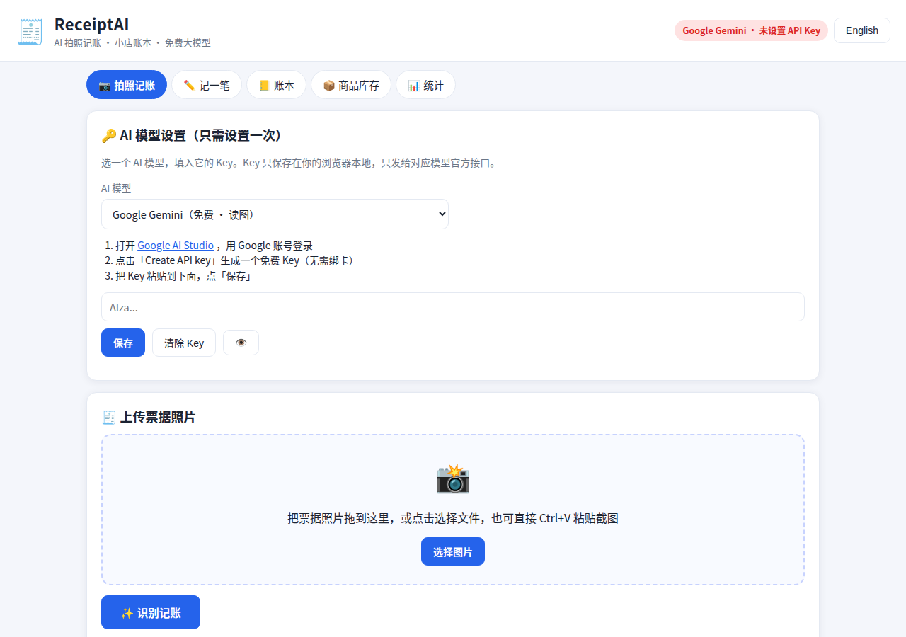

# ReceiptAI 🧾 — AI Photo Bookkeeping for Small Shops

> Snap a receipt → AI reads it → it lands in your ledger. Free, private, no server.

**[Live Demo](https://hejiajie071005.github.io/receipt-ai/)** · Open `index.html` and it just works — no build step, no install.



## What it does

| Feature | Description |
|---|---|
| 📷 AI receipt scan | Photograph a receipt/bill (or paste the text for DeepSeek); your chosen AI — Gemini, Qwen or DeepSeek — reads merchant, date, line items, total |
| ✏️ Manual entries | Income / expense entries with date, category, amount, cost, note |
| 🧮 Profit calculator | Sell price − cost = profit; margins on sell price **and** on cost |
| 📒 Ledger | Filter by month / type / category / keyword; edit & delete any entry |
| 📦 Inventory | Products with cost / sell price / stock; selling auto-deducts stock, books income + profit, and prints an e-receipt |
| 📊 Dashboard | This month's income, expense, gross & net profit, overall margin; category breakdown; daily income/expense trend chart |
| 🧾 E-receipts | Generate a receipt on every sale — download as PNG or print |
| 💾 Backup | Export CSV (with profit columns) and full JSON backup; restore from JSON |
| 🔌 API docs | Copy-paste cURL / JS snippets for Gemini, Qwen and DeepSeek to call the same AI from your ordering system |

## Supported AI models

Pick a model in the app (Scan tab → AI model). Each model has its own key, stored separately in your browser. Switch anytime — the ledger, profit and inventory features work the same for all three.

| Model | Vision | How to get a key | Notes |
|---|---|---|---|
| **Google Gemini** | ✅ reads photos | [Google AI Studio](https://aistudio.google.com/apikey) — free tier, no card | Default. `gemini-2.0-flash`, auto-falls back to `gemini-1.5-flash`. |
| **通义千问 Qwen** | ✅ reads photos | [阿里云百炼控制台](https://bailian.console.aliyun.com/) — new users get free quota | Domestic (China), fast. `qwen-vl-max`, auto-falls back to `qwen2.5-vl-72b-instruct`. OpenAI-compatible endpoint. |
| **DeepSeek** | ❌ text only | [DeepSeek open platform](https://platform.deepseek.com/api_keys) | **DeepSeek's official API does not accept images (yet).** Paste the receipt/order text and DeepSeek structures it into the same JSON. Use it when you already have the text, or when the other two are unavailable. |

## How to get an API key

1. Pick a model above and open its key page.
2. Create a key (Gemini: **Create API key** in AI Studio, free, no card; Qwen: **API-KEY** in the Bailian console; DeepSeek: **Create API key** on the platform).
3. Paste the key into ReceiptAI (top of the Scan tab, under the matching model) and click **Save**.

That's it. If a free quota runs out, the app tells you clearly — switch to another model or try again later.

## How to use

1. **Scan** — pick a model, upload / drag / paste a receipt photo (or paste the text for DeepSeek) → **Recognize & Book** → check the editable result → **Save to ledger**.
2. **Add entry** — record income or expense by hand; for income, fill in the cost price and the profit is computed live. The profit calculator on the same page works standalone too.
3. **Ledger** — browse, filter, edit, delete; export CSV or JSON backup.
4. **Inventory** — register products (cost / sell price / stock); sell one and the stock, ledger and receipt update automatically. Stock below 5 is highlighted red.
5. **Stats** — monthly totals, category breakdown and the daily trend chart at a glance.

## API reference

Recognize one receipt (same call the app makes):

```
POST https://generativelanguage.googleapis.com/v1beta/models/gemini-2.0-flash:generateContent?key=YOUR_API_KEY
Content-Type: application/json
```

```json
{
  "contents": [{
    "parts": [
      {"text": "Extract the receipt into JSON: {\"merchant\": string, \"date\": \"YYYY-MM-DD\", \"items\": [{\"name\": string, \"qty\": number, \"unit_price\": number, \"amount\": number}], \"subtotal\": number, \"tax\": number, \"total\": number, \"currency\": string, \"category\": string}. Reply with JSON only."},
      {"inline_data": {"mime_type": "image/jpeg", "data": "BASE64_IMAGE_HERE"}}
    ]
  }],
  "generationConfig": {"response_mime_type": "application/json", "temperature": 0.1}
}
```

cURL and a `fetch` snippet are also in the app (Scan tab → API docs), with copy buttons. If `gemini-2.0-flash` ever returns 404, fall back to `gemini-1.5-flash` — the app does this automatically.

### Qwen (OpenAI-compatible, vision)

```
POST https://dashscope.aliyuncs.com/compatible-mode/v1/chat/completions
Authorization: Bearer YOUR_API_KEY
Content-Type: application/json
```

```json
{
  "model": "qwen-vl-max",
  "messages": [{"role": "user", "content": [
    {"type": "image_url", "image_url": {"url": "data:image/jpeg;base64,BASE64_IMAGE_HERE"}},
    {"type": "text", "text": "Extract the receipt into JSON: {...}. Reply with JSON only."}
  ]}]
}
```

Response: `choices[0].message.content` (JSON string). If `qwen-vl-max` is unavailable, use `qwen2.5-vl-72b-instruct` — the app falls back automatically.

### DeepSeek (text only — no image input)

DeepSeek's official API does not accept images. Paste or OCR the receipt text first, then:

```
POST https://api.deepseek.com/v1/chat/completions
Authorization: Bearer YOUR_API_KEY
Content-Type: application/json
```

```json
{
  "model": "deepseek-chat",
  "messages": [{"role": "user", "content": "Extract the receipt text into JSON: {...}. Reply with JSON only.\n\nReceipt text:\nPASTED_RECEIPT_TEXT_HERE"}],
  "temperature": 0.1,
  "response_format": {"type": "json_object"}
}
```

Response: `choices[0].message.content` (JSON string). All three models return the same JSON shape, so the result flows into the same editable form and ledger.

### Response example

```json
{
  "merchant": "好又多超市",
  "date": "2026-10-27",
  "items": [
    {"name": "可乐 330ml", "qty": 6, "unit_price": 3.5, "amount": 21.0},
    {"name": "方便面", "qty": 10, "unit_price": 4.0, "amount": 40.0}
  ],
  "subtotal": 61.0, "tax": 0, "total": 61.0,
  "currency": "CNY", "category": "进货"
}
```

## Profit math

- **Profit** = sell price − cost price
- **Margin (on sell price)** = profit ÷ sell price × 100%
- **Margin (on cost)** = profit ÷ cost price × 100%
- **Net profit (month)** = gross profit (sales − cost of goods) − expenses

## Privacy

- Ledger, products and API keys are stored in your browser's `localStorage` only.
- Receipt photos / pasted text are sent to the **selected model's official API only** when you click Recognize.
- No analytics, no accounts, no server. Export/erase your data anytime (JSON backup in the Ledger tab; clearing browser data wipes everything).

## Tech

Pure HTML + CSS + vanilla JS. No framework, no build step. `html2canvas` is vendored locally (`vendor/`) so receipt-image export works fully offline. Charts are hand-drawn with CSS/JS — no chart library.

## License

MIT © 2026 He Jiajie

---

# ReceiptAI 🧾 — 小店 AI 拍照记账

> 拍一张小票 → AI 读出内容 → 自动记进账本。免费、私密、无服务器。

**[在线演示](https://hejiajie071005.github.io/receipt-ai/)** · 打开 `index.html` 就能用，不用安装、不用构建。

## 能做什么

| 功能 | 说明 |
|---|---|
| 📷 AI 拍照识别 | 拍小票/发票照片（DeepSeek 用粘贴文字），所选模型——Gemini、千问或 DeepSeek——读出商家、日期、明细、总金额 |
| ✏️ 手动记账 | 收入/支出，日期、分类、金额、成本、备注 |
| 🧮 利润计算器 | 卖出价 − 成本价 = 利润；同时显示按卖出价和按成本价的利润率 |
| 📒 账本 | 按月份/类型/分类/关键词过滤；每笔可编辑、删除 |
| 📦 商品库存 | 登记商品（进货价/卖出价/库存）；卖出一件自动扣库存、记收入和利润、生成电子小票 |
| 📊 统计 | 本月收入、支出、毛利、净利润、整体利润率；分类汇总；每日收支趋势图 |
| 🧾 电子小票 | 每次卖出生成小票，可下载图片或打印 |
| 💾 备份 | 导出带利润列的 CSV 和完整 JSON 备份；可从 JSON 导入恢复 |
| 🔌 API 文档 | 可复制的 cURL / JS 代码片段（Gemini、千问、DeepSeek 三个模型），把同样的 AI 识别接进你的下单系统 |

## 支持的 AI 模型

在 App「拍照记账」页顶部选模型。每个模型有自己的 Key，分开存在浏览器里。随时可以切换——账本、利润、库存功能对三个模型都一样。

| 模型 | 能读图吗 | Key 获取 | 说明 |
|---|---|---|---|
| **Google Gemini** | ✅ 能读图 | [Google AI Studio](https://aistudio.google.com/apikey) — 免费套餐，无需绑卡 | 默认模型。`gemini-2.0-flash`，失败自动换 `gemini-1.5-flash`。 |
| **通义千问 Qwen** | ✅ 能读图 | [阿里云百炼控制台](https://bailian.console.aliyun.com/) — 新用户有免费额度 | 国内模型，速度快。`qwen-vl-max`，失败自动换 `qwen2.5-vl-72b-instruct`。OpenAI 兼容接口。 |
| **DeepSeek** | ❌ 只能读文字 | [DeepSeek 开放平台](https://platform.deepseek.com/api_keys) | **DeepSeek 官方接口目前不支持传图片。**把小票/订单文字粘贴进来，DeepSeek 整理成同样的记账 JSON。适合已经有文字、或前两个模型暂时不可用时。 |

## API Key 获取方法

1. 在上面选一个模型，打开它的 Key 申请页面。
2. 创建 Key（Gemini：在 AI Studio 点 **Create API key**，免费、无需绑卡；千问：在百炼控制台 **API-KEY 管理**里创建；DeepSeek：在开放平台创建 API Key）。
3. 粘贴到 ReceiptAI「拍照记账」页顶部对应模型的输入框，点「保存」。

免费额度用完 App 会明确提示，换个模型或晚点再试就行。

## 使用方法

1. **拍照记账**：先选模型，上传/拖入/粘贴小票照片（DeepSeek 则粘贴文字）→ 点「识别记账」→ 核对可修改的结果 →「保存到账本」。
2. **记一笔**：手动记收入或支出；收入填成本价会自动算利润。同页有独立利润计算器。
3. **账本**：查看、筛选、编辑、删除；导出 CSV 或 JSON 备份。
4. **商品库存**：登记商品（进货价/卖出价/库存）；卖出自动扣库存、记收入利润、出小票。库存低于 5 件标红提醒。
5. **统计**：本月收支、利润、分类汇总、每日趋势一目了然。

## API 接口

识别一张票据（和 App 内部调用完全一致）：

```
POST https://generativelanguage.googleapis.com/v1beta/models/gemini-2.0-flash:generateContent?key=YOUR_API_KEY
```

完整请求体、cURL 示例和 JS `fetch` 示例见 App 内「拍照记账 → API 接口文档」，带一键复制。`gemini-2.0-flash` 若返回 404，可改用 `gemini-1.5-flash`（App 已自动 fallback）。

### 千问 Qwen（OpenAI 兼容接口 · 读图）

```
POST https://dashscope.aliyuncs.com/compatible-mode/v1/chat/completions
Authorization: Bearer YOUR_API_KEY
Content-Type: application/json
```

```json
{
  "model": "qwen-vl-max",
  "messages": [{"role": "user", "content": [
    {"type": "image_url", "image_url": {"url": "data:image/jpeg;base64,BASE64_IMAGE_HERE"}},
    {"type": "text", "text": "Extract the receipt into JSON: {...}. Reply with JSON only."}
  ]}]
}
```

返回：`choices[0].message.content`（JSON 字符串）。`qwen-vl-max` 不可用时可用 `qwen2.5-vl-72b-instruct`（App 已自动 fallback）。

### DeepSeek（只读文字 · 不支持传图）

DeepSeek 官方接口目前不接受图片。先把小票/订单文字用 OCR 或手动抄录成文本，再调用：

```
POST https://api.deepseek.com/v1/chat/completions
Authorization: Bearer YOUR_API_KEY
Content-Type: application/json
```

```json
{
  "model": "deepseek-chat",
  "messages": [{"role": "user", "content": "Extract the receipt text into JSON: {...}. Reply with JSON only.\n\nReceipt text:\nPASTED_RECEIPT_TEXT_HERE"}],
  "temperature": 0.1,
  "response_format": {"type": "json_object"}
}
```

返回：`choices[0].message.content`（JSON 字符串）。三个模型返回的 JSON 结构完全一致，都会进同一个可修改的结果表单和账本。

## 利润计算

- **利润** = 卖出价 − 成本价
- **利润率（按卖出价）** = 利润 ÷ 卖出价 × 100%
- **利润率（按成本价）** = 利润 ÷ 成本价 × 100%
- **净利润（月）** = 毛利润（销售额 − 货品成本）− 支出

## 隐私

- 账本、商品、Key 只存在浏览器 `localStorage`。
- 照片/文字只在点「识别」时发给**所选模型官方接口**。
- 无统计、无账号、无服务器。随时可导出/清除数据（账本页的 JSON 备份；清浏览器数据即全部清除）。

## 技术

纯 HTML + CSS + 原生 JS，无框架、无构建。`html2canvas` 已本地引入（`vendor/`），小票图片导出可离线使用。图表为手写 CSS/JS，无图表库。

## 开源协议

MIT © 2026 He Jiajie
